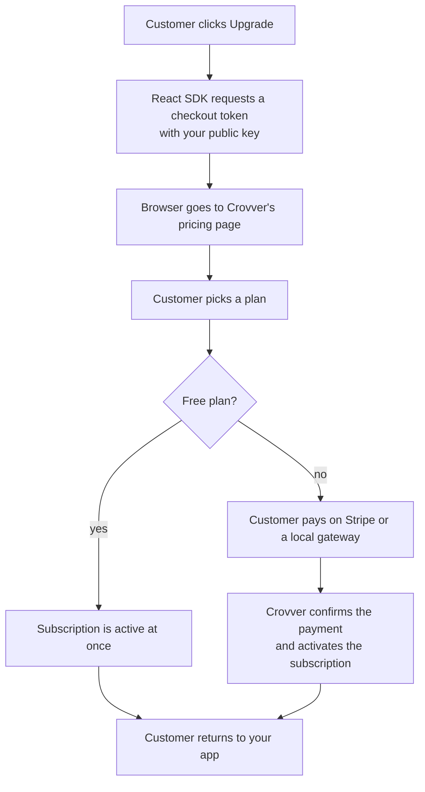

There are two ways to start a checkout:

- **Hosted pricing page**: your frontend sends the customer to Crovver's pricing page, where they pick a plan and pay. This needs only the React SDK.
- **Backend checkout**: your backend creates a checkout for a plan you choose and redirects the customer to pay. Use this when you build your own pricing page.

## Hosted pricing page



### 1. Send the customer to the pricing page

```tsx
import { useBillingRedirect } from "crovver-react";

const { redirectToCheckout } = useBillingRedirect();

redirectToCheckout();                                   // every published plan
redirectToCheckout({ productSlug: "acme-workspace" });  // one product's plans
redirectToCheckout({ requiredFeature: "data-export" }); // pre-select a plan with this feature
```

The SDK asks Crovver for a short-lived checkout token, valid for 10 minutes, and redirects to the pricing page with it. The token carries your organization and the customer, so the page shows your published plans.

If the customer does not exist yet, this first checkout creates it from the provider's `tenantId`, `tenantName`, `userId` and `metadata.userEmail`.

### 2. The customer picks a plan and pays

- **Free plan**: the subscription is active immediately. No payment provider is involved.
- **Stripe**: the customer pays on Stripe's checkout page. Crovver activates the subscription when Stripe confirms the payment, usually within seconds.
- **ConnectIPS**: the customer pays on the gateway's page, then comes back. Crovver confirms the payment with the gateway before activating.

### 3. The customer comes back

The customer lands on Crovver's confirmation page, then returns to your app. Refresh the subscription when they arrive:

```tsx
const { refresh, isActive } = useSubscription();

useEffect(() => {
  refresh();
}, []);
```

Don't treat the return itself as proof of payment. Rely on `isActive`, `canAccess`, or the `subscription.activated` [webhook](/guides/outgoing-webhooks).

## Backend checkout

Create the checkout from your backend with the secret key, then redirect the customer to the returned URL:

```typescript
const checkout = await crovver.createCheckoutSession({
  externalTenantId: "workspace_123",
  externalUserId: "user_123",
  userEmail: "jane@acme.com",
  planId: "6f1c…",                       // the plan's ID from getPlans()
  provider: "stripe",
  successUrl: "https://yourapp.com/billing/success",
  cancelUrl: "https://yourapp.com/pricing",
});

// crovver-node 1.8.0's types don't include the free-plan fields yet
const result = checkout as typeof checkout & { isFree?: boolean; successUrl?: string };

if (result.isFree) {
  redirect(result.successUrl!);           // already active
} else {
  redirect(result.checkoutUrl!);          // pay first
}
```

For a per-seat plan, pass the seat count as `totalCapacityUnits`. For a D2C product, omit `externalTenantId`: the customer is keyed on `externalUserId`.

A free plan needs no `provider`. Its response has `isFree: true` and a `successUrl` instead of a `checkoutUrl`.


## When checkout is refused

| Response | Why |
|---|---|
| `409` | The customer already has a live subscription to this product. Cancel it first. See [Changing plans](/concepts/subscriptions#changing-plans). |
| `409 SUBSCRIPTION_ENDING` | The customer canceled a subscription to this product that is still in its paid period. They can subscribe again when it ends. |
| `404` | The plan does not exist, or it or its product is not published. |
| `422 CURRENCY_NOT_SUPPORTED` | The plan has no price in the requested currency. |

## The billing page

Once subscribed, customers manage billing on Crovver's billing page: invoices, cancellation, seats and add-ons. Send them there with `redirectToBilling()` from `useBillingRedirect`.

The first time a customer opens the billing page in a browser, Crovver emails a one-time sign-in link to the customer's billing email. The link is valid for 15 minutes, and the sign-in lasts 7 days in that browser. A customer without a billing email sees a message asking them to contact you, so always set one. See [Customers](/concepts/tenants#the-billing-email).

Checkout itself never asks for this sign-in.
