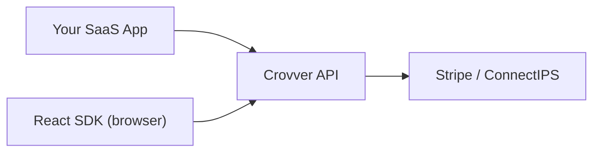

Crovver is a **subscription management layer** that sits between your SaaS application and your payment providers. It handles billing logic, subscription state, feature entitlements, seat tracking, and usage limits — so you don't have to.

## Why Crovver?

Building billing is slow, fragile, and a distraction from your core product. Crovver gives you:

<CardGroup cols={2}>
  <Card title="Payment Provider Agnostic" icon="credit-card">
    Use Stripe, or ConnectIPS for NPR, without changing your
    application code.
  </Card>
  <Card title="Entitlement Engine" icon="lock">
    Gate features by plan in one line. No custom permission logic needed.
  </Card>
  <Card title="Seat-Based Billing" icon="users">
    Built-in capacity tracking with proration on upgrades. Works for B2B
    workspaces out of the box.
  </Card>
  <Card title="Metered Credits" icon="chart-bar">
    Give each plan an allowance of API calls, AI tokens or messages. Crovver
    meters it, refills it every period and blocks usage when it runs out.
  </Card>
</CardGroup>

## How It Works

Crovver exposes a set of APIs your app calls, a React SDK for the frontend, and a webhook receiver for payment provider events. Your app never talks to Stripe directly — Crovver does.

**Crovver never stores payment credentials.** All provider secrets are managed through a secrets manager (Infisical or Vault).

## Key Primitives

| Concept          | Description                                                     |
| ---------------- | --------------------------------------------------------------- |
| **Organization** | Your company, which owns everything else                        |
| **Product**      | Something you sell, to companies (B2B) or individuals (D2C)     |
| **Plan**         | A price, plus the features and meter allowances it grants       |
| **Customer**     | Who pays you: a workspace or a person. The API calls it a tenant |
| **Subscription** | A customer subscribed to a plan                                 |
| **Entitlement**  | Whether a customer can use a feature                            |
| **Credits**      | A customer's remaining allowance on a meter                     |

## Next Steps

<CardGroup cols={2}>
  <Card title="Quickstart" icon="rocket" href="/quickstart">
    Get your first subscription running in under 10 minutes.
  </Card>
  <Card title="Core Concepts" icon="book" href="/concepts/organizations">
    Understand the data model before you integrate.
  </Card>
  <Card title="React SDK" icon="react" href="/react-sdk/installation">
    Add paywalls and feature gates to your frontend.
  </Card>
  <Card title="API Reference" icon="code" href="/api-reference/overview">
    Full reference for every endpoint.
  </Card>
</CardGroup>
